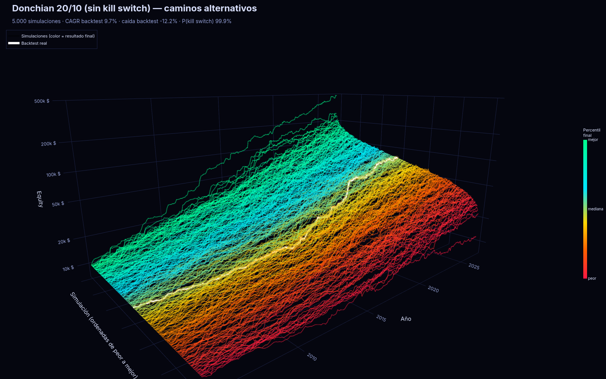
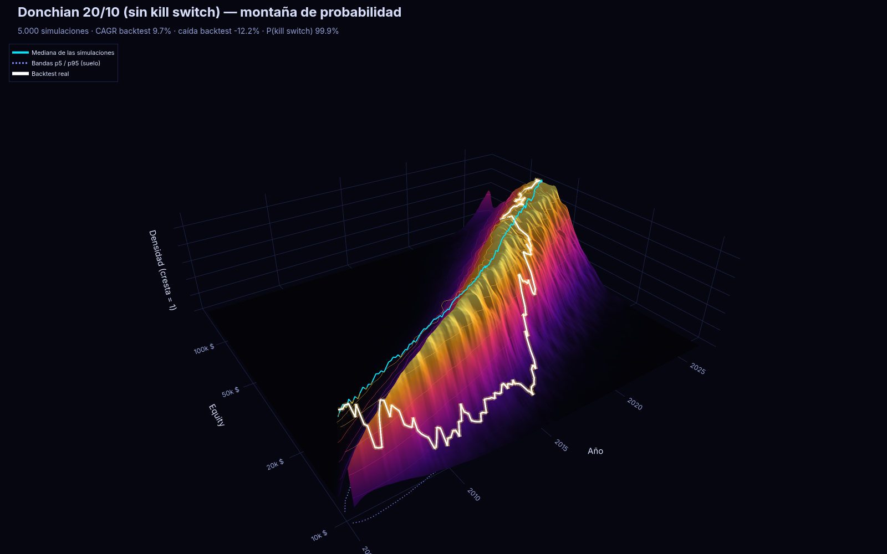
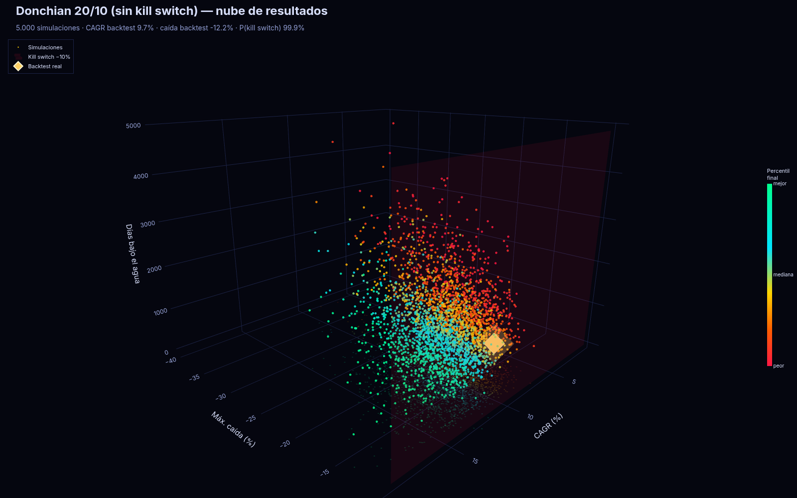

# Monte Carlo — ¿el backtest fue un camino afortunado?

Preparado el 11 nov 2026 (hora de Madrid) por Grok Bot, **sin usar Claude**, para poder
usarlo mañana en las pruebas con Fable. El código vive en la rama `prep/motor-backtest`.
Esto no es una predicción ni una garantía: es una prueba de robustez sobre un backtest
**ya corrido**.

## Qué es, en claro

Un backtest es **un solo camino**: el orden en que ocurrieron las operaciones (o los días)
en la historia real. Si las pérdidas grandes se agrupan al principio, el drawdown (la
caída desde un máximo) es peor que si esas mismas pérdidas se reparte entre ganancias.
Una simulación de Monte Carlo baraja o remuestrea ese historial miles de veces y pinta
todos los caminos juntos, como un **abanico**. Sirve para preguntar:

- ¿El camino que ya vimos era típico, o de los afortunados?
- ¿En qué porcentaje de esos caminos se habría tocado el **kill switch** (parada de
  emergencia: caer más de un 10 % desde el máximo)?
- ¿Con qué probabilidad se termina por debajo del capital inicial, o se toca un umbral
  de «ruina» (por defecto, perder un 20 % desde el inicio)?

No cambia las reglas de la estrategia ni predice el futuro. Solo remueve el azar del
**orden** (o de la muestra) sobre los resultados que ya tenemos.

## Los tres métodos

| Método | Qué hace | Cuándo usarlo | Qué cambia |
|---|---|---|---|
| `shuffle` | Baraja el orden de las operaciones cerradas, **sin** repetir ninguna | Estrategias con lista de operaciones y P&L (Donchian, etc.) | El equity final y el CAGR **no cambian** (la suma no depende del orden). Sí cambia el camino y el drawdown. |
| `bootstrap` | Reconstruye la lista de operaciones **con reemplazo** (algunas se repiten, otras no salen) | La misma, cuando quieres ver también qué pasa si la muestra de operaciones hubiera sido otra | Cambia el equity final, el CAGR y el drawdown. |
| `block` | Parte la curva diaria en bloques (por defecto 21 días, ~un mes) y los remuestrea con reemplazo | Estrategias mensuales **sin** operaciones cerradas con P&L (Faber, TSMOM, dual momentum, buy & hold), o como complemento | Cambia todo. Conserva un poco la racha de días seguidos (la autocorrelación dentro del bloque). |

El sizing por defecto es **aditivo**: se baraja el P&L en dólares de cada operación ya
cerrada, no se vuelve a calcular el 1 % sobre el equity del momento. Hay un modo
`compound` (fracción fija sobre los múltiplos R) si se quiere; en ese caso, al barajar
sin reemplazo, el *producto* de los factores tampoco cambia, así que el equity final
sigue siendo el mismo.

## Cómo leer los gráficos

- **Abanico (fan chart).** Las bandas cubren el 90 % (p5–p95) y el 50 % (p25–p75) de
  los caminos simulados. La línea de puntos es la mediana. La línea roja gruesa es el
  backtest. Las líneas finas grises son una **muestra** (unas 60), no las 5000.
  - En `shuffle` / `bootstrap` el eje X es el **número de operación** (el equity solo
    se actualiza al cerrar). No es el calendario diario.
  - En `block` el eje X son **días**, la misma longitud que el backtest.
- **Histograma de drawdown.** La línea roja discontinua es el kill switch (10 %). Si
  mucha masa queda a la izquierda, la estrategia saltaría la parada de emergencia a
  menudo al reordenar el azar. La línea verde es el drawdown del backtest (misma
  construcción que las sims).
- **Histograma de CAGR.** En `shuffle` suele ser una sola barra (no cambia). En
  `bootstrap` y `block` sí hay distribución.

«Rango del real» (percentil) es el porcentaje de simulaciones con un valor **menor o
igual** al del backtest. En el CAGR, un rango alto significa que el histórico ganó más
que la mayoría (posible suerte en la muestra). En el drawdown, que es negativo, un rango
alto significa que el histórico cayó *menos* que la mayoría (camino más suave, también
puede ser suerte en el orden).

## Cómo correrlo mañana

Desde la raíz del repo, con el entorno de `uv` y los datos en `data_cache/`:

```bash
uv sync

# Ver qué backtests hay (carpetas con equity.csv)
uv run python scripts/montecarlo.py --list

# Sobre un informe ya existente (p. ej. el Donchian IS o uno nuevo de Fable)
uv run python scripts/montecarlo.py --run reports/donchian_atr/is_20261111-0140 --method shuffle --n 5000 --seed 42

# Exportar las curvas de las baselines de referencia (si no están) y correr Monte Carlo
uv run python scripts/montecarlo.py --prepare-baselines
uv run python scripts/montecarlo.py --run reports/baselines/20261111-0141/donchian_nokill --method shuffle
uv run python scripts/montecarlo.py --run reports/baselines/20261111-0141/donchian_nokill --method bootstrap
uv run python scripts/montecarlo.py --run reports/baselines/20261111-0141/donchian_nokill --method block
uv run python scripts/montecarlo.py --run reports/baselines/20261111-0141/faber_sma_spy --method block
uv run python scripts/montecarlo.py --run reports/baselines/20261111-0141/tsmom_12m_spy --method block
uv run python scripts/montecarlo.py --run reports/baselines/20261111-0141/tsmom_12m_1n --method block
```

En cada carpeta del backtest se escriben:

- `montecarlo_<método>_resumen.md` — informe en español
- `montecarlo_<método>_stats.csv` — percentiles y probabilidades
- `montecarlo_<método>.html` — gráficos interactivos. Ábrelo en el navegador desde
  el repo clonado: el JavaScript de plotly está una sola vez en
  `reports/assets/plotly.min.js` (ruta relativa). No hace falta red. GitHub no
  ejecuta bien estos HTML; mejor en local.
- `montecarlo_<método>_fan.png` — la misma figura, por si no quieres abrir el HTML

Opciones útiles: `--block 21` (longitud del bloque), `--kill 0.10`, `--ruin 0.20`,
`--out <carpeta>`, `--cdn-html` (HTML más ligero, necesita red para verlo).

### Visor local (opcional)

Una ventana en el navegador para elegir un backtest, el método, N y la semilla, y ver
los gráficos al momento. Está pensado para acabar siendo una **pestaña** del
visualizador de estrategias, cuando lo montemos.

```bash
uv sync --extra visor
uv run streamlit run scripts/visor_montecarlo.py
```

## Vista 3D (para verlo en el móvil)

Un HTML interactivo con cuatro pestañas. Funciona sin internet, porque plotly.js va incrustado (pesa unos 10 MB). Se abre en el navegador del móvil o del PC: arrastra para girar, pellizca para hacer zoom, y el botón 🌀 lo pone a girar solo.

| Pestaña | Qué se ve | Cómo leerlo |
|---|---|---|
| 🌌 Caminos | 300 simulaciones en 3D (eje X = tiempo, Y = simulación ordenada de peor a mejor, Z = equity en escala log), coloreadas de rojo (peor final) a verde (mejor). | El hilo blanco con brillo dorado es el backtest real. Si va por la zona verde, el backtest tuvo suerte; si va por el medio, fue un camino normal. |
| 🏔️ Montaña | Superficie de densidad: en cada momento, dónde se concentran los caminos (la cresta es el nivel de dinero más probable). | La montaña se ensancha con el tiempo, porque la incertidumbre crece. Si la línea blanca del backtest va por la ladera, fue un camino poco típico. |
| 💎 Resultados | Una nube de puntos con una simulación por punto: CAGR × peor caída × días bajo el agua, coloreados por percentil final. Lleva un plano rojo en el kill switch (−10 %). | El diamante dorado es el backtest. Lo que queda a la izquierda del plano rojo habría disparado el kill switch. |
| ▶️ Animación | 120 caminos que crecen a la vez desde el mismo punto. | Se ve cómo se abre el abanico. Se puede girar mientras se mueve. |

La cabecera trae las cifras clave sacadas de la propia simulación: CAGR y caída del backtest, rango de las simulaciones, P(kill switch), P(ruina) y P(acabar en pérdidas).

```bash
# HTML 3D (se guarda junto al backtest: montecarlo_block_3d.html)
uv run python scripts/montecarlo_3d.py --run donchian_nokill --method block \
    --title "Donchian 20/10 (sin kill switch)"
uv run python scripts/montecarlo_3d.py --run tsmom_12m_1n --method block \
    --title "TSMOM 12m 1/N (5 ETFs)"

# Además, 3 PNG de preview (necesita kaleido + Chrome; kaleido ya está en el grupo dev)
uv run python scripts/montecarlo_3d.py --run donchian_nokill --png --png-prefix /tmp/mc3d

# Vídeo girando (~10 s, MP4 con ffmpeg). Tarda unos 13 min: renderiza 240 fotogramas
uv run python scripts/montecarlo_3d.py --run donchian_nokill --spin /tmp/mc3d_spin.mp4

# Con cualquier backtest nuevo de Fable (método shuffle/bootstrap si tiene trades.csv)
uv run python scripts/montecarlo_3d.py --run <carpeta_o_id> --method shuffle
```

En el visor Streamlit (`uv run streamlit run scripts/visor_montecarlo.py`), debajo de la tabla aparece una sección **Vista 3D** con las tres primeras pestañas.

HTML ya generados (ábrelos descargándolos desde GitHub; GitHub no ejecuta el HTML en la vista previa):

- [Donchian sin kill switch, 3D](../reports/baselines/20261111-0141/donchian_nokill/montecarlo_block_3d.html): CAGR del backtest 9,7 %, simulaciones entre 6,0 % y 13,7 % (p5–p95); caída del backtest −12,2 % frente a una mediana de −17,3 % y −26,1 % en el p5; P(kill switch) 99,9 %.
- [TSMOM 12m 1/N, 3D](../reports/baselines/20261111-0141/tsmom_12m_1n/montecarlo_block_3d.html): CAGR del backtest 6,3 %, simulaciones entre 3,5 % y 9,5 %; caída del backtest −15,8 % frente a una mediana de −19,1 % y −30,5 % en el p5; P(kill switch) 99,9 %; P(ruina) 2,1 %.





Notas:

- La vista 3D es la misma simulación que el abanico 2D; no añade información estadística, solo la enseña de otra forma.
- La montaña usa la **densidad relativa**: cada instante se escala para que su cresta valga 1. Así se ve cómo se ensancha la distribución sin que el pico inicial (donde todos los caminos están en 10.000 $) aplaste el resto. La altura no se puede comparar entre fechas.
- Para que el HTML pese poco, se pintan 300 caminos (estratificados por resultado final, siempre con el peor y el mejor) y unos 260 instantes de tiempo. Las métricas usan las 5000 simulaciones completas.
- `MCConfig(keep_paths=True)` guarda la matriz N×T entera en memoria: con 5000 × 6900 son unos 280 MB.

## Resultados de las baselines de referencia

Corridos el 11 nov 2026 (hora de Madrid) con **N = 5.000**, semilla **42**, kill switch
al 10 %, umbral de ruina al 20 %, bloques de 21 días. Capital inicial 10.000 $. Las
cifras salen de los `montecarlo_*_stats.csv` / `*_resumen.md` de
`reports/baselines/20261111-0141/<slug>/`. No se ha reoptimizado nada. Las curvas
reproducen exactamente los CAGR y drawdowns de `docs/baselines.md`.

### Donchian 20/10 sin kill switch (SPY, QQQ, BTC)

Equity final del backtest: 74.899 $. CAGR 9,7 %. El drawdown *a mercado* (cada día,
el de `docs/baselines.md`) es **−12,2 %**. El de la trayectoria de P&L al cerrar
operaciones (con el que se comparan `shuffle` y `bootstrap`) es **−8,6 %**.

| Método | CAGR backtest vs mediana | Máx. DD backtest vs mediana (p5 / p95) | Rango del DD | P(kill switch) | P(ruina 20 %) | P(bajo el inicio) |
|---|---|---|---|---|---|---|
| shuffle | 9,7 % (no cambia al barajar) | −8,6 % vs −15,5 % (−34,5 % / −7,5 %) | 91 | 84,6 % | 11,4 % | 0 % |
| bootstrap | 9,7 % vs 9,5 % (rango 54) | −8,6 % vs −16,0 % (−36,7 % / −7,3 %) | 90 | 82,8 % | 13,6 % | 0 % |
| block (diario) | 9,7 % vs 9,6 % (rango 50) | −12,2 % vs −17,3 % (−26,1 % / −12,6 %) | 97 | 99,9 % | 0,6 % | 0 % |

Lectura breve:

- Al barajar o remuestrear operaciones, el camino histórico tuvo un drawdown más
  suave que ~90 % de las simulaciones, pero **en más del 80 %** de los caminos se
  habría tocado el kill switch del 10 % (aunque el camino real, medido solo al
  cerrar, se quedó en −8,6 % y no lo tocó).
- Con rentabilidades diarias (`block`), el CAGR histórico es típico (percentil 50),
  pero el drawdown de −12,2 % es de los más suaves (mejor que el ~97 % de las
  sims; la mediana cae un 17,3 %). Y el kill switch habría saltado en el **99,9 %**
  de las historias alternativas. En un backtest de ~22 años, un Donchian con estas
  reglas casi siempre llega a caer más de un 10 % desde un máximo. Eso importa
  para la pregunta de Fable sobre si el kill switch permanente es utilizable como
  criterio de aprobado.

### Estrategias mensuales (solo `block`, van al 100 % del capital, sin stop)

| Baseline | CAGR backtest vs mediana | Máx. DD backtest vs mediana (p5 / p95) | Rango CAGR / DD | P(kill 10 %) | P(ruina 20 %) | P(bajo el inicio) |
|---|---|---|---|---|---|---|
| Faber SMA 10 meses (SPY) | 7,8 % vs 8,1 % | −25,9 % vs −26,4 % (−41,1 % / −18,2 %) | 46 / 54 | 100 % | 8,1 % | 0,08 % |
| TSMOM 12m (SPY) | 9,4 % vs 9,7 % | −33,7 % vs −31,7 % (−49,4 % / −19,9 %) | 46 / 41 | 100 % | 12,8 % | 0,04 % |
| TSMOM 12m 1/N | 6,3 % vs 6,5 % | −15,8 % vs −19,1 % (−30,5 % / −13,3 %) | 46 / 78 | 99,9 % | 2,1 % | 0,02 % |

Los tres caminos de 2005–2026 son típicos en CAGR (percentil ~46). TSMOM 1/N tuvo un
drawdown más suave que la mayoría (rango 78); TSMOM de solo SPY, un poco más
exigente (rango 41). Que el kill switch del 10 % salte casi siempre **es lo
esperado**: estas baselines van invertidas al 100 % y no cumplen las reglas duras.
Un SPY o un TSMOM a full capital cae más de un 10 % en cualquier historia larga
que se parezca a esta. No las uses para juzgar el umbral del 10 %; para eso mira
el Donchian, que sí dimensiona al 1 %.

## Advertencias (léelas antes de creerte el abanico)

1. **Independencia.** Barajar trata cada operación (o cada bloque de días) como
   intercambiable. En la realidad, una racha de pérdidas puede tener una causa común
   (un régimen de mercado). El Monte Carlo no la ve.
2. **`shuffle` no cambia el CAGR** si el sizing es aditivo o de fracción fija: la suma
   y el producto no dependen del orden. Solo el camino y el drawdown son sensibles al
   orden. Para hablar de suerte en el *resultado final*, usa `bootstrap` o `block`.
3. **P&L realizado vs marcado a mercado.** En `shuffle`/`bootstrap` el equity de las
   sims solo se actualiza al **cerrar** cada operación. No captura el vaivén de las
   posiciones abiertas ni el drawdown intradía. El drawdown «a mercado» del backtest
   (el de `docs/baselines.md`) puede ser peor. Por eso el informe enseña las dos
   cifras y compara las sims con la trayectoria de P&L realizado, no con la diaria.
4. **Kill switch.** Las simulaciones **no se detienen** al tocarlo: se deja seguir el
   camino para ver la distribución completa, y se cuenta cuántas lo habrían tocado.
   Eso no es lo mismo que aplicar la regla literal (parar para siempre), que es lo que
   hace el motor en `portfolio_sim`.
5. **Posiciones solapadas.** El Donchian puede tener hasta 3 operaciones abiertas a la
   vez. Barajar P&L cerrados ignora esa superposición.
6. **Un solo periodo, una sola muestra.** 2005–2026 incluye un mercado alcista largo
   en EE. UU.; BTC solo entra desde 2015. Remuestrear esa historia no inventa otros
   mundos, solo reordena *esta*.
7. Las estrategias mensuales (Faber, TSMOM) **no cumplen** las reglas duras (van al
   100 %, sin stop ni sizing al 1 %). El Monte Carlo no arregla eso; solo habla de la
   robustez de *esa* simulación de referencia.

Si una candidata de Fable «aprueba» el backtest pero el abanico dice que el camino fue
de los más afortunados, o que el kill switch salta en la mayoría de las sims, eso es
información para el veredicto: no relajar los criterios.
