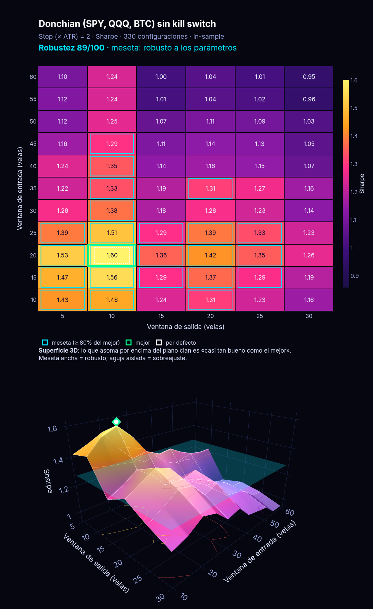
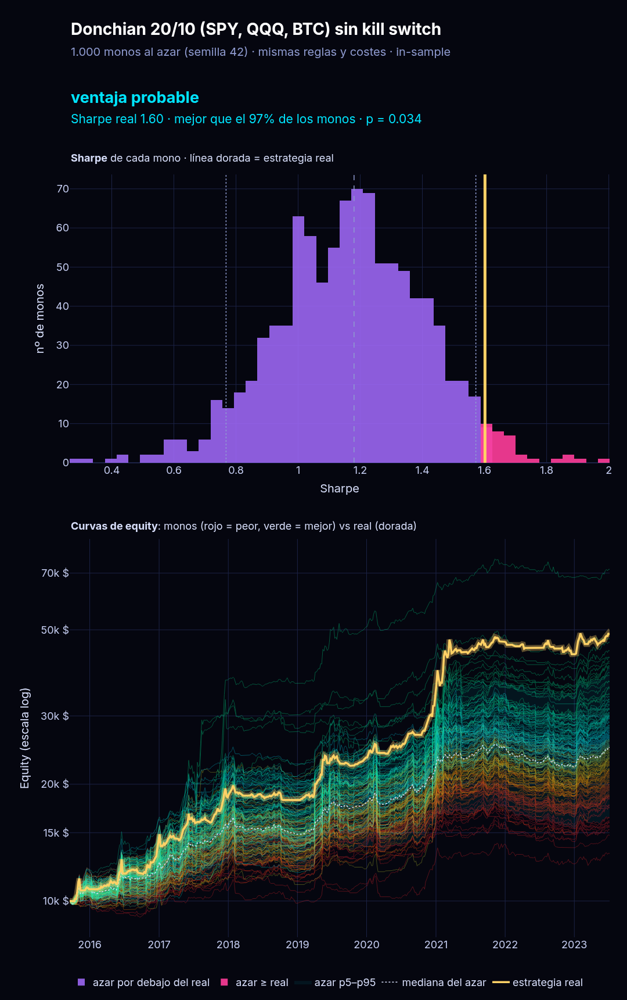

# ROBUSTEZ — mapa de parámetros y «contra el azar»

Dos herramientas para la pregunta que viene **después** de un buen backtest: *¿es real o es
suerte?* Complementan al Monte Carlo (`docs/MONTECARLO.md`), que responde otra cosa (si el
**camino** fue afortunado). Preparado el 11 nov 2026 (hora de Madrid) por Grok Bot, sin usar
Claude, en la rama `prep/motor-backtest`. **Nada de esto envía órdenes.**

| herramienta | pregunta que responde | script | salida |
|---|---|---|---|
| Mapa de parámetros | Si muevo un poco los parámetros, ¿el resultado aguanta (**meseta**) o se hunde (**pico** = sobreajuste)? | `scripts/param_sweep.py` | `reports/robustez/<slug>/sweep_<periodo>_<fecha>/` |
| Contra el azar («monos») | ¿Mis entradas valen algo, o 1000 estrategias que entran al azar con las mismas reglas lo hacen igual? | `scripts/random_benchmark.py` | `reports/robustez/<slug>/azar_<periodo>_<fecha>/` |

> **Regla de oro:** son herramientas de **robustez, no de optimización**. Nunca elijas los
> parámetros mirando el mapa (eso es justo el sobreajuste que intentan detectar). Se usan sobre
> los parámetros **ya pre-registrados**, y solo **in-sample**.



---

## 1. Mapa de parámetros (`param_sweep.py`)

### Qué hace
1. Recorre una rejilla de **2 o 3 parámetros** (p. ej. 11 × 6 × 5 = 330 combinaciones).
2. Cada combinación se ejecuta con el **motor real**: `portfolio_sim` (riesgo 1 % con stop,
   máx. 3 posiciones, exposición ≤ 100 %, kill switch del 10 % salvo `--no-kill-switch`) y los
   costes de `config/settings.toml` (`--costs base|stress|zero`). Las estrategias mensuales por
   pesos (Faber, TSMOM) usan `allocation_sim`, que **no tiene kill switch** (se avisa).
3. En paralelo (`joblib`, `--n-jobs -1`) y con **caché** en `state/cache/param_sweep/` (la
   clave incluye datos, costes, reglas y parámetros; repetir un barrido tarda segundos).
4. Calcula una **puntuación de robustez 0–100** en la métrica elegida (`--metric`, por
   defecto Sharpe) y avisos de sobreajuste.
5. Calcula **Deflated Sharpe Ratio (DSR)** y **PBO por CSCV** (16 bloques → 12 870 particiones).
6. Anota el barrido en `docs/registro_pruebas.md` **con el nº de configuraciones** (cuentan
   como variantes probadas para el DSR de futuras pruebas).

### Cómo leer la puntuación
`robustez = 100 × (0,5·vecinos + 0,3·min(1, meseta/30 %) + 0,2·mediana/mejor)`

- **vecinos**: % de las celdas adyacentes al mejor que quedan dentro del 20 % (`--tol`) de su
  valor. ¿Si tuerzo un parámetro un paso, sigue bien?
- **meseta**: % del mapa en la zona buena **conectada** al mejor.
- **mediana/mejor**: si el mejor es 3× la mediana, es una aguja.
- **≥ 70 meseta** (robusto) · **40–70 mixto** · **< 40 pico** (sospechoso). Es una regla
  práctica, no un test estadístico. Con «Máx. caída» se puntúa 1/|caída| (más alto = mejor).

### DSR y PBO, en una línea cada uno
- **DSR** (Bailey y López de Prado): probabilidad de que el Sharpe del mejor sea real
  descontando que se eligió el máximo de N intentos (y la asimetría/curtosis). Fiarse si **≥ 0,95**.
  N cuenta el barrido y lo ya anotado en el registro. Las configuraciones vecinas están muy
  correladas, así que N exagera los intentos independientes (DSR conservador).
- **PBO**: parte la historia en 16 bloques, prueba todas las mitades; en cada una elige la mejor
  configuración en la mitad A y mira en qué puesto queda en la mitad B. PBO = % de veces que
  queda **por debajo de la mediana**. < 10 % bien · 10–50 % regular · ≥ 50 % «elegir la mejor»
  no sirve.
- **Meseta ancha + PBO alto** no es contradictorio: significa que muchas configuraciones son
  casi iguales y cuál gana depende del tramo. Conclusión: **no optimizar**, quedarse con los
  parámetros pre-registrados.

### Archivos
`sweep.csv` (una fila por combinación, todas las métricas) · `robustez.json` (puntuaciones,
DSR, PBO, avisos) · `resumen.md` (en castellano) · `mapa.html` (interactivo y autocontenido,
funciona sin internet y en el móvil: mapa de calor con selector de métrica y deslizador del 3.er
parámetro, superficie 3D con plano de «casi tan bueno», histograma del PBO) · `mapa.png` (preview).

En el mapa: recuadro **cian** = meseta, **verde** = mejor, **blanco punteado** = parámetros por
defecto. En 3D lo que asoma por encima del plano cian es la zona «casi tan buena como el mejor».

---

## 2. Contra el azar (`random_benchmark.py`)

### Qué hace
Genera **N = 1000 estrategias al azar** (semilla fija, reproducible y con independencia del nº de
procesos) **emparejadas** con la real y las pasa por el mismo motor:

- **Estrategias de señales** (Donchian…): mismo nº de operaciones por activo, misma duración
  (se toman las duraciones de las salidas de la estrategia que **no** fueron por stop y se
  calibran con 3 rondas de pilotos, porque los stops acortan las operaciones al azar), misma
  exposición aproximada, **mismo stop, sizing 1 %, máx. 3 posiciones y costes**. Solo cambia
  **cuándo** se entra.
- **Estrategias por pesos** (TSMOM, Faber): asignaciones mensuales al azar con **la misma
  rotación**: mismas carteras, mismo nº de cambios y mismos meses en cada cartera; solo cambia el
  orden y la longitud de los tramos.

Luego compara: percentil de la estrategia real entre los monos y **p-valor empírico**
`p = (1 + nº de monos ≥ real) / (N + 1)` (una cola) en Sharpe, CAGR, máx. caída, MAR y expectancy.

### Umbrales del veredicto (fijados antes de mirar)
| p-valor | veredicto |
|---|---|
| p < 0,05 | **ventaja probable** |
| 0,05 ≤ p < 0,10 | **indicio débil** (no concluyente) |
| p ≥ 0,10 | **indistinguible del azar** |

El resumen incluye una tabla «¿Se parecen los monos a la real?» (operaciones, duración,
exposición o rotación). **Si no se parecen, el test no vale**: revísala siempre.

### Archivos
`azar.csv` (una fila por mono) · `azar_resumen.csv` · `azar.json` · `curvas.csv.gz` (200
curvas de equity) · `resumen.md` · `azar.html` (histograma, violines y «espaguetis» de curvas
coloreadas de peor a mejor con la real en dorado) · `azar.png`.



---

## 3. Comandos

```bash
uv sync
# Mapa de parámetros (in-sample por defecto)
uv run python scripts/param_sweep.py --preset donchian       # 330 combinaciones, sin kill switch
uv run python scripts/param_sweep.py --preset donchian2d     # 2D rápido (entry_n × exit_n)
uv run python scripts/param_sweep.py --preset tsmom_spy      # meses 1–24 × salto 0–2
uv run python scripts/param_sweep.py --preset faber_spy
# A medida: 1–3 ejes con nombre=a:b[:paso] o nombre=v1,v2
uv run python scripts/param_sweep.py --strategy donchian_atr --universe SPY QQQ BTC/USD \
    --grid entry_n=10:60:5 --grid exit_n=5:30:5 --metric mar --no-kill-switch

# Contra el azar
uv run python scripts/random_benchmark.py --preset donchian   # 1000 monos, semilla 42
uv run python scripts/random_benchmark.py --preset tsmom_spy
uv run python scripts/random_benchmark.py --strategy <id> --n 1000 --seed 42

# Visor (Monte Carlo + mapa + azar en pestañas; también lanza barridos nuevos, solo IS)
uv sync --extra visor && uv run streamlit run scripts/visor.py
# el comando antiguo sigue funcionando y abre lo mismo:
uv run streamlit run scripts/visor_montecarlo.py
```

Opciones útiles: `--costs stress` (costes ×2), `--start AAAA-MM-DD`, `--n-jobs 4`,
`--no-cache`, `--no-registry` (solo para pruebas; no anota), `--out carpeta`, `--no-png`.

**Out-of-sample:** `--period oos|full` se **niega** (código de salida 3) salvo con
`--confirm-oos`, y además pasa por la misma guarda que `runner.py` (`reports/oos_log.csv`). El
OOS se toca **una vez**, en el paso 3, con la candidata congelada. Un barrido en OOS es elegir
parámetros mirando el examen: **no lo hagas**.

---

## 4. Resultados de referencia (11 nov 2026, in-sample, yfinance, costes base)

| prueba | resultado | lectura |
|---|---|---|
| Donchian 20/10/2 (SPY, QQQ, BTC), **sin kill switch** — mapa 11×6×5 = 330 | Robustez **89/100 (meseta)**; mejor Sharpe 1,60 justo en los parámetros por defecto; mediana 1,21; vecinos 88 %; meseta 31 %. DSR 0,999; **PBO 33 %** | Robusto en Sharpe; en MAR sale **pico** (25/100) y en CAGR/caída «mixto». Riesgo de sobreajuste moderado si se eligiera «la mejor». |
| Donchian — contra 1000 monos | Sharpe 1,60, percentil 97 %, **p = 0,034 → ventaja probable**. CAGR p = 0,015; MAR p = 0,005; máx. caída p = 0,115; expectancy p = 0,055 | Las entradas aportan algo frente a entrar al azar con las mismas reglas (en este tramo). |
| TSMOM (SPY) — mapa meses 1–24 × salto 0–2 = 72 (69 válidas) | Robustez **97/100 (meseta)**; mejor 0,67 en 19 meses/salto 2; **el 12/0 por defecto da 0,49 (percentil 25 %, fuera de la meseta)**. DSR 0,969; **PBO 87 %** | Muchas variantes casi iguales y cuál gana depende del tramo: no optimizar. |
| TSMOM 12m (SPY) — contra 1000 monos | Sharpe 0,49, percentil 68 %, **p = 0,326 → indistinguible del azar**; máx. caída p = 0,077 (indicio débil) | En SPY solo, el TSMOM no distingue sus meses de una rotación al azar con la misma rotación; como mucho reduce algo la caída. |

Informes completos (md, csv, html, png):

- `reports/robustez/donchian_atr_nokill/sweep_is_20261111-0454/`
- `reports/robustez/donchian_atr_nokill/azar_is_20261111-0455/`
- `reports/robustez/tsmom_12m_spy/sweep_is_20261111-0454/`
- `reports/robustez/tsmom_12m_spy/azar_is_20261111-0455/`

---

## 5. Advertencias (léelas antes de creerte nada)

- **Solo in-sample** (Donchian 2015-09-17 → 2023-07-06; TSMOM SPY 2005-01-01 → 2020-04-20).
  Nada de esto dice cómo irá fuera de muestra.
- **Donchian sin kill switch**, como las baselines informativas. Con la regla del 10 % el mismo
  Donchian IS da Sharpe 0,68 (registro): los números cambian mucho. Repite con kill switch antes
  de cualquier veredicto.
- **Emparejamiento imperfecto en Donchian**: los monos hacen ~110 operaciones (real 116),
  duración media 29,0 velas (real 29,75) pero **exposición 40 % frente a 46 %** de la real (la real
  queda en el p95). Menos exposición en un mercado alcista penaliza algo a los monos en CAGR; el
  Sharpe se ve menos afectado. Está en la tabla de emparejamiento de `azar_is_*/resumen.md`.
- **TSMOM tiene muy poca potencia estadística**: 11 cambios de asignación en 15 años. Con tan
  pocas decisiones, «indistinguible del azar» también puede ser «no hay datos para decidir».
- Las estrategias por pesos (`allocation_sim`) **no aplican las reglas duras** (ni stop ni kill
  switch): son baselines informativas, igual que en `docs/baselines.md`.
- Datos de **yfinance** (ajustados), no Alpaca. BTC cotiza 7 días; acciones 5.
- p-valores y DSR **no** son pruebas de que la estrategia gane dinero; solo de que lo observado
  no se explica fácilmente por la suerte **en este tramo y con estas reglas**.
- Cada barrido suma intentos al registro: más barridos ⇒ DSR más exigente. Es intencionado.

## 6. Código y tests

`src/tlab/backtest/`: `targets.py` (estrategia + periodo + motor), `param_sweep.py`,
`overfit.py` (PSR, DSR, PBO-CSCV), `random_benchmark.py`, `robust_reports.py` (md/csv/json,
registro, guarda OOS), `robust_viz.py` (tema oscuro neón como `montecarlo3d`). Scripts:
`scripts/param_sweep.py`, `scripts/random_benchmark.py`, `scripts/visor.py`.
Tests sin red: `tests/test_param_sweep.py`, `tests/test_overfit.py`,
`tests/test_random_benchmark.py` (estrategias «oráculo» y sin ventaja), `tests/test_visor.py`.
También se añadió el parámetro opcional `skip` a `tsmom` (por defecto 0, mismo resultado que antes).
